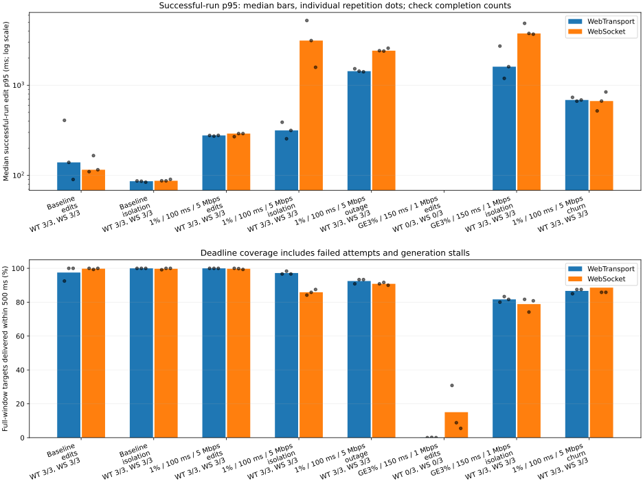
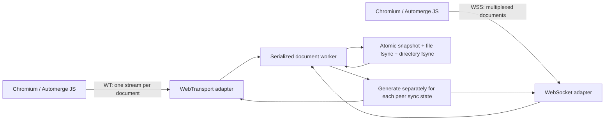

# Automerge over WebTransport

An experiment with raw Automerge sync over a WebTransport bidirectional stream per document, compared with document multiplexing over one WSS connection. This is a custom protocol, not Automerge Repo. The adjacent `wtransport` repository is not used or modified.

## Measured results

Measurements collected on October 24, 2026. The two suites measure different things: the worldwide Rust/Lambda suite measures request/reply RTT through a Northern California relay; the controlled Linux/Chromium suite measures edit propagation between browser clients. Both transports use the same sync engine and durable snapshots, with WebSocket TCP_NODELAY enabled and compression disabled.

### Unreliable links

**48 attempts: 42 converged, six failed.** Three repetitions per condition, with a configured ten-second warmup and sixty-second measurement window. The suite covers random and burst loss, jitter, bandwidth limits, bulk transfers alongside small control edits, temporary blackouts, and **141 completed reconnects** while edits continue.

| Control edits during four concurrent bulk downloads | WebTransport p95 | WebSocket p95 | Converged WT / WSS |
|---|---:|---:|---:|
| 1% directional loss, 100 ms added RTT, 5 Mbps | 1.17 s | 6.09 s | 3/3 · 3/3 |
| ≈3% directional burst loss, 150 ms added RTT, 1 Mbps | 4.15 s | 6.89 s | 3/3 · 3/3 |

These are medians of successful per-run p95 values **during the bulk-transfer window**, with one control edit per client per second and four 256 KiB documents on the same session. WT uses an independent stream per document; WSS multiplexes documents on one ordered connection. Bulk-window sample counts are exported; these tail estimates are coarse.



The chart shows whole-measurement edit p95 and full-window delivery coverage, with individual repetition dots. All-attempt deadline coverage includes disconnected clients, generation stalls and late/missing observations. Failed attempts are excluded from successful-latency summaries and remain visible in completion counts.

Both transports failed all three five-edits-per-second load attempts under the severe burst-loss profile. Four attempts explicitly logged full document queues; two WT attempts logged “cancelled or overloaded” without a more precise cause. These results describe this implementation and its queue/time limits. Reliable CRDT synchronization still requires delivery; this suite does not test unreliable datagrams or IP migration.

[Detailed unreliable-link report](docs/benchmarks/resilience/REPORT.md) · [Comparison CSV](docs/benchmarks/resilience/comparison.csv) · [Every attempt](docs/benchmarks/resilience/attempts.csv) · [Full observations and network counters](docs/benchmarks/resilience/results.json) · [Reproduce](bench/RESILIENCE.md)

### Worldwide AWS regions

**17 regions, 289 directed region pairs, three repetitions per transport. All 1,734 attempts converged.** There are 8,670 measured request/reply RTTs per transport. Median latency was within 5% between transports on **288 of 289 pairs**.

| Transport | Pooled median RTT | Pooled p95 RTT |
|---|---:|---:|
| WebTransport | 259.61 ms | 406.82 ms |
| WebSocket | 259.53 ms | 403.66 ms |

Pooled percentiles combine geographic paths; use the region-pair CSV for a particular path. Traffic traverses the durable `us-west-1` relay in both directions. These include Automerge processing and snapshot fsync. City-proxy distances are geographic estimates, not measured packet routes. This small-message suite does not exercise cross-stream isolation.

[Worldwide methodology and results](docs/benchmarks/global-comparison/REPORT.md) · [All region pairs and distances](docs/benchmarks/global-comparison/comparison.csv) · [Distance/latency chart](docs/benchmarks/global-comparison/distance-latency.svg)

All persisted worldwide snapshots passed independent verification. Temporary AWS resources and controlled-network containers were removed after measurement. The published benchmark bundle contains no deployment credentials or private keys.

## Run the demo

Requires Rust ≥1.90, Node ≥22.12, OpenSSL, and Google Chrome. Docker is needed for controlled networks and ARM64 deployment. Dependencies are locked in `Cargo.lock` and `package-lock.json` (wtransport **0.7.2**, Rust Automerge **0.12.0**, JavaScript Automerge **3.2.0**).

```sh
cd automerge-wtransport
./scripts/cert.sh
EXPERIMENT_TOKEN=local-experiment-token ./scripts/run-local.sh
# In a second terminal:
npm run demo
```

Enter the same token in the demo, choose a transport, create a document, and copy its share link into another dedicated-profile tab. Tokens are shared separately and are not included in share links. Multiple documents can remain open; select one in the sidebar. Disconnect, edit offline, and reconnect to merge. IndexedDB retains documents. Each newly loaded browser instance gets a new Automerge actor, including when loading persisted state.

`scripts/open-demo.mjs` creates a persistent dedicated Chromium profile at `.chromium-profile` (override with `PROFILE_DIR`). It trusts **only this certificate's SPKI** with `--ignore-certificate-errors-spki-list`; it does not globally ignore certificate errors. WebTransport additionally pins the certificate's SHA-256 DER hash from `/config`. Certificates use ECDSA P-256 and ten-day validity (renew and redeploy before expiration). Demo IndexedDB storage survives browser restarts in that profile; benchmark and test profiles are temporary and removed on close. Two tabs in the same profile share IndexedDB; actors are independent, but concurrently writing the same local snapshot key is last-writer-wins. Server history and live tab state still merge through Automerge.

HTTPS serves `/`, `/config`, `/healthz`, `/ws` and authenticated `/metrics` on **TCP 4433**. WebTransport accepts `/sync?token=…` on **UDP 4433**. `/ws` also requires that token. This is experimental token access, not production account management. The token must be ≥16 characters and URL safe. WebSocket compression is not enabled. WSS and QUIC use the same certificate and Rustls provider; TLS 1.3 is used by QUIC, and Chromium negotiates TLS 1.3 for WSS.



## Native Rust WebTransport client

`wt-client` uses the same binary protocol, canonical schema, and raw Automerge sync messages as the browser. It validates the server certificate using a SHA-256 DER pin (or system CA roots if no pin is supplied).

```sh
cargo build --bins --locked
# Start the demo server in another terminal, then:
EXPERIMENT_TOKEN=local-experiment-token cargo run --bin wt-client -- \
  --url https://localhost:4433 --cert-hash certs/hash.hex \
  --doc 12345678-1234-1234-1234-123456789abc \
  --snapshot /tmp/my-rust-client.automerge --append 'Hello from Rust 🌍'
# Follow edits from other clients until Ctrl-C:
EXPERIMENT_TOKEN=local-experiment-token cargo run --bin wt-client -- \
  --cert-hash certs/hash.hex --doc 12345678-1234-1234-1234-123456789abc --watch
```

`--set` replaces text; `--append` inserts text at its end. JSON output includes text, heads and acknowledgement. A snapshot is loaded with a new actor and saved after sync; use a separate snapshot file per client. `--timeout` bounds connection/sync waits (default 30 seconds). Tokens come from `EXPERIMENT_TOKEN`, not command-line arguments. `cargo run` without a binary still starts the server.

The library exports `client::{Client, WebSocketClient, Options, Document}`. `WebSocketClient` is the pinned TLS 1.3 benchmark adapter; it opens one document per connection and shares the same `Document` sync engine. Open multiple documents on a shared client session, edit using `set_text`, `append`, or `document_mut`, and call `sync` to await agreement on known heads. Drive `receive` to follow remote updates; its idle timeout is cancellation-safe because a bounded background reader owns frame parsing. A full/failed reader closes the stream; reconnect using a saved document with fresh sync state. Documents retain the connection even if the client handle is dropped. `Client::close` explicitly closes all streams. Synchronization is not a global barrier against future concurrent edits.

```sh
cargo test --locked
node scripts/rust-client-test.mjs
```

Native integration tests use ephemeral certificates and servers and cover concurrent Unicode edits, multiple streams/document isolation, snapshot resume, dropped client handles, idle reads, invalid pins and tokens, wrong-document rejection, bounded readers and sync deadlines. The Chromium check covers Rust/WSS interoperability, CLI snapshot recovery, and watch/interrupt behavior.

## Protocol and durability

Both adapters carry the same binary envelope: `version:u8=1 | type:u8 | UUID:16 bytes | raw Automerge payload`. Types are OPEN=1, SYNC=2, CLOSE=3. OPEN/CLOSE have no payload. WebTransport adds a big-endian u32 envelope length. Readers handle fragmented headers, fragmented payloads, and coalesced messages. One WT stream cannot change its document UUID. WSS messages each contain exactly one envelope.

Every new document starts from the checked-in canonical `schema.automerge` / `web/schema.json` snapshot, so even simultaneous offline first edits share the same text object. Keep that initial change stable. The worker owns the document and an independent `automerge::sync::State` for each subscription. Receiving changes and generating messages are serialized. Changed heads trigger a full snapshot, temporary-file fsync, rename, and parent-directory fsync **before any resulting sync responses are queued**. A persistence error cancels every subscriber to that document. A process lock prevents two servers from using the same data directory. Acknowledgement means Automerge's `hasOurChanges` confirms the server knows those changes; it is not a separate application ACK frame.

Inbound worker queues and outbound transport queues are bounded. Each outbound stream/connection also has a byte budget of twice the maximum frame. Overload cancels the affected subscriber, without dropping messages and continuing with advanced sync state. Reconnect starts fresh sync state. WT write and initial-open timeouts are ten seconds. Worker cleanup removes peer state; document workers stay resident until the single server exits (maximum 1024 documents). The 16 MiB frame cap limits **encoded sync messages**, not decoded Automerge memory. The experiment intentionally uses full snapshots; snapshot and CRDT costs can dominate transport differences.

| Environment variable       | Default                                                             |
| -------------------------- | ------------------------------------------------------------------- |
| `EXPERIMENT_TOKEN`         | required                                                            |
| `DATA_DIR`                 | `data`                                                              |
| `PORT`                     | `4433` TCP and UDP                                                  |
| `CERT`, `KEY`, `CERT_HASH` | `certs/cert.pem`, `certs/key.pem`, `certs/hash.hex`                 |
| `WEB_DIR`                  | `dist`                                                              |
| `MAX_FRAME`                | 16777216 bytes (18 bytes–64 MiB)                                    |
| `QUEUE_CAPACITY`           | 8 messages, inbound per document and outbound per stream/connection |
| `MAX_SESSIONS`             | 256 shared across WT and WSS                                        |

Each connection opens up to 64 documents; a document accepts up to 256 peers. WT streams isolate document delivery, but CPU, disk, the document registry, and the session remain shared resources. There is no automatic eviction, distributed server coordination, incremental persistence, production authentication, or Repo compatibility.

## Correctness checks

```sh
npm ci
npm run build
cargo test --locked
cargo build --locked
npm test
cargo clippy --all-targets -- -D warnings
```

Tests use a real Chrome with the experiment SPKI pin, without disabling all TLS verification. They cover Rust/JS WT compatibility; mixed WSS/WT subscribers; concurrent Unicode edits; document isolation and stream close; independent IndexedDB actor reload; concurrent offline changes; reconnect churn and subscription cleanup; abrupt server kill, direct snapshot heads/content comparison, restart, and fresh-client download; malformed and oversized frames; incremental framing; bounded inbound queues; stalled outbound queues; and cancellation on persistence failure. `results/correctness.json` and a browser screenshot record the run. The helper starts a temporary server and data directory on TCP/UDP 4444. Keep that port free.

## Benchmarks

Build **release** binaries for measurements. Debug-build CRDT and snapshot costs produce substantially different saturation behavior. These commands do not need a demo server running. Benchmarks use temporary dedicated browser profiles and nonpersistent client documents; the same `Client` class and transport adapters drive the demo and benchmark.

```sh
cargo build --release --locked
# Complete default localhost suites (long-running):
node bench/run.mjs
# A focused full-duration comparison:
SUITES=edits OUTPUT=results/localhost-edits.json node bench/run.mjs
# Explicitly labelled quick functional coverage:
SUITES=initial,edits,isolation,stress,churn,stalled,oversized \
  REPETITIONS=1 WARMUP_SECONDS=1 MEASURE_SECONDS=3 node bench/run.mjs
```

Defaults: three repetitions, ten-second warmup, sixty-second measurement, alternating WT/WSS execution order, and a fresh server/data directory per transport/case/repetition. Seeding is deterministic xorshift32 with seed 49217. Initial synchronization repeatedly downloads a seeded document into fresh browser clients during the measurement window; the setup transfer is recorded separately. Connection readiness is measured after page/wasm load, from `Client.connect()` through `/config` and transport readiness. Initial sync includes document OPEN through client/server heads agreement. Edit workloads generate five appended timestamp markers per client per second. All observer clients are on one clock host; propagation uses `performance.timeOrigin + performance.now()` and is checked against both head and text convergence. Percentiles include only markers generated within the measurement window, and can include delivery during final drain. Client warmup bytes are excluded from server measurement-byte deltas. Browser application-byte totals include setup; server measurement deltas are the throughput basis. Outbound application bytes count messages queued for transport; they are offered bytes and can include messages not written before a failed connection closes. Propagation observation throughput is exported separately from generated-edit throughput. TLS/QUIC/TCP overhead is not estimated.

Suites:

- `initial`: two clients, 64 KiB, 1 MiB, 8 MiB seeded text.
- `edits`: two clients, 64 KiB, five edits per client per second.
- `isolation`: a seeded 8 MiB second document opens alongside small-document edits (1 MiB remotely).
- `stress`: 2, 8, 32, 128 clients (remote 2, 4, 8). Higher client counts stop after a failed case; failures at the current load are retained.
- `churn`: one client disconnects and reconnects every two seconds while editing.
- `stalled`: freeze one real Chromium renderer while another appends 16 KiB five times per second. Chromium's networking process can continue draining transport buffers; this is a stalled **application** scenario, not proof that OS/TCP buffers stop. The deterministic Rust stalled-reader test separately forces an outbound queue to fill.
- `oversized`: encoded messages above the frame cap must be rejected; ordinary peers must still converge.

`SUITES`, `SIZES`, `CLIENTS`, `REPETITIONS`, `WARMUP_SECONDS`, `MEASURE_SECONDS`, `OUTPUT`, and `BENCH_PORT` select runs. Nondefault timing/repetition counts are marked `quick`. `KINDS`, `REPETITION_INDEX`, and `EXPECTED_REPETITIONS` support the controlled-network orchestrator. `CLIENT_TIMEOUT_MS` defaults to 120000; convergence and transport readiness have shorter bounded timeouts. Stop increasing load after failure. During macOS stress-client creation, a browser-process RSS guard stops the run above 4 GiB by default (`MAX_BROWSER_RSS_MB`); controlled clients also have Docker memory limits. Remote RSS/cgroup pressure stops the entire run. Do not compare results from concurrently running benchmarks or builds.

Queue high-water counters record attempted occupancy, so a rejected enqueue can report capacity plus one. Raw JSON includes durations, every measured propagation latency, percentiles, edit and byte throughput, readiness, queue high-water marks, overloads, disconnects, convergence errors, process CPU/RSS samples, browser/OS/hardware, quotas, seed, and dependencies. Linux CPU uses `/proc/self/stat` cumulative CPU ticks at 100 Hz; macOS samples `ps %cpu` and RSS. CPU sampling method differs by OS. Automated page and convergence checks add driver traffic outside the measured edit phase. Browser TLS test flags are restricted to the experiment pin; `https.get` skips certificate validation only for harness health/metric polling.

### Controlled Linux networks

Docker Desktop needs approximately 8 GiB. Impairment is entirely inside a dedicated Linux router container; no host network settings change. The client and server are on different bridge networks, with explicit routes through that router. Both directions, TCP and UDP, traverse the same `tc netem` queues.

```sh
# All suites, all three profiles (long-running):
python3 bench/controlled.py
# Focused comparisons:
SUITES=edits python3 bench/controlled.py
# Short topology / transport check:
PROFILES=baseline SUITES=edits REPETITIONS=1 WARMUP_SECONDS=1 \
  MEASURE_SECONDS=3 python3 bench/controlled.py
# Emergency experiment-only cleanup:
docker compose -f bench/compose.yml down --remove-orphans
```

Profiles: `baseline`; `rtt50-loss01-20mbit` (25 ms each direction, 0.1% directional loss, 20 Mbps each direction); `rtt150-loss1-5mbit` (75 ms each direction, 1% loss, 5 Mbps). Queues have 10000-packet limits. Every transport/case/repetition recreates the server container, whose data is ephemeral. Server quota is one CPU / 1 GiB; clients get four CPUs / 5 GiB. The orchestrator removes containers/networks on exit. It never uses `tc` on macOS or the remote host. Profiles and actual router device names are captured in output.

### Remote shared, constrained host

Target: Ubuntu ARM64 `xwing-coop`, `i-0a4a44c4ac1e0b42b`, `52.9.189.226`, `us-west-1`. Existing game services keep port 443. Use normal AWS CLI credentials; all management goes through SSM, not SSH.

```sh
# Build the ARM64 binary in Docker; dist must already exist:
docker build --platform linux/arm64 --target server -t automerge-wtransport:server .
python3 deploy/remote.py deploy
python3 deploy/remote.py status
python3 deploy/remote.py logs
python3 deploy/remote.py health
# Direct Mac browser clients, with no simulated impairment:
EXPERIMENT_TOKEN="$(cat certs/token)" BASE_URL=https://52.9.189.226:4433 \
  BENCH_ENV=remote RESET_COMMAND='python3 deploy/remote.py reset' \
  OUTPUT=results/remote.json node bench/run.mjs
python3 deploy/remote.py stop
python3 deploy/remote.py cleanup
# Only if snapshots should also be removed:
python3 deploy/remote.py cleanup --purge-snapshots
```

Deployment creates a private temporary S3 artifact bucket with public access blocked and SSE-S3 encryption, uploads the ARM64 binary/assets/certificate, fetches a short-lived presigned object URL over HTTPS through SSM, and removes the bucket after successful deployment. Failed deployment state is recorded in `deploy/state.json`; cleanup uses the recorded rule IDs and bucket. The service uses its own Unix user, `/opt/automerge-wtransport`, timestamped snapshot directories in `/var/lib/automerge-wtransport`, `MemoryMax=256M`, `MemoryHigh=220M`, and `CPUQuota=25%`. Ingress rules are individually described and restricted to the benchmark client's discovered IPv4 `/32`. The token is in mode-600 `certs/token` locally and `/etc/automerge-wtransport.env` remotely.

Remote defaults prohibit more than eight clients and documents above 1 MiB. `/metrics` reports RSS/cgroup memory; the client stops on pressure. A dedicated guard checks that existing xwing services stay active, their local `/health` endpoint stays healthy, and host available RAM stays ≥128 MiB. It stops only the experiment on degradation. Reset checks existing-service health and switches to a **new snapshot directory**, preserving previous snapshots. Cleanup stops/removes only named experiment services, files, and ingress-rule IDs; snapshots and their Unix user remain unless `--purge-snapshots` is used. For a changed binary/certificate, cleanup then deploy again. After cleanup, snapshot deletion requires a new explicit administrative action; the old deployment state is gone.

## Reports

```sh
python3 bench/report.py results/localhost-edits.json results/controlled-combined.json results/remote.json
```

Exports `comparison.csv`, per-observation `latencies.csv`, `resources.csv`, readiness/transfer `durations.csv`, and standalone `edit-latency.svg` / `initial-sync.svg`. Failed runs remain labelled; no transport is assumed to win. Compare within environments, not across different CPU quotas, Chromium builds, or operating systems. The historical browser runs in `RESULTS.md` used the earlier default TCP acceptor, so their Linux tail differences may include Nagle/delayed-ACK effects. The published comparisons above use explicit TCP_NODELAY. Compare results within the same measured configuration. See `RESULTS.md` for the measurements actually performed and the remaining coverage.

Protocol references: [Automerge sync model](https://github.com/automerge/automerge/blob/main/rust/automerge/src/sync.rs), [wtransport 0.7.2](https://docs.rs/wtransport/0.7.2/wtransport/), [WebTransport certificate hashes](https://w3c.github.io/webtransport/#dom-webtransportoptions-servercertificatehashes).

`./scripts/measure-focused.sh` runs the full-duration edit comparison sequentially on localhost, all three controlled profiles, and the deployed remote host, then stops the remote experiment and exports reports. Deploy first; the script expects `certs/token`. It retains remote failures and continues to status/stop/report generation.

## Worldwide Rust/Lambda latency benchmark

The [Terraform workflow](infra/global-latency/README.md) deploys Rust WebTransport and WebSocket clients in every enabled commercial AWS region and measures pairwise request/reply RTT through a dedicated relay. Both transports share one sync engine and alternate execution order. It includes preflights, a bounded/reproducible region matrix, convergence checks, JSON/CSV/heatmap reports, and snapshot-preserving Terraform cleanup. These are relay-mediated application measurements, not direct Lambda-to-Lambda QUIC or one-way network latency.

## Unreliable-link benchmarks

The [network resilience suite](bench/RESILIENCE.md) compares reliable sync on random-loss, burst-loss, jittered, bandwidth-limited and temporarily disconnected links. It includes small control edits alongside four concurrent bulk document downloads, exposes completion failures and whole-window deadline coverage, and keeps the [controlled-network report](docs/benchmarks/resilience/REPORT.md) separate from the worldwide unmodified-network measurements.
